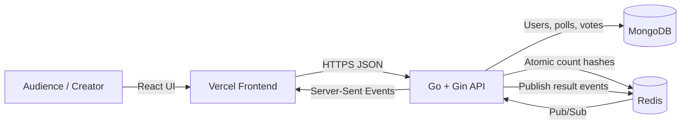

# Pulse live polls

Pulse is a small live polling app: authenticated creators make a poll, share its URL, and an audience votes while every open poll page updates without refresh.

## Live deployment

- Frontend: https://pulse-frontend-three-rose.vercel.app/
- Backend: https://pluse-7hrb.onrender.com/
- Health check: https://pluse-7hrb.onrender.com/health

## Architecture



MongoDB is the durable source of truth for accounts, polls, and unique vote records. Redis stores the live counter hash for each poll and pub/sub broadcasts complete result updates. Gin validates requests and manages the MongoDB/Redis/SSE flow. React opens an EventSource for each shared poll and updates result bars as messages arrive.

## Stack

- `frontend/`: React + Vite single-page app
- `backend/`: Go + Gin API
- MongoDB: users, polls, and one-vote-per-voter records
- Redis: live counter hashes and pub/sub events consumed by Server-Sent Events

## Run locally

Requirements: Docker Desktop.

```powershell
docker compose up --build
```

Open http://localhost:5173. Create an account, create a poll, then open its generated URL in another browser window to vote. The creator view receives Redis pub/sub events through the Go SSE endpoint.

Without Docker, start MongoDB and Redis separately, run `go run .` in `backend`, and run `npm install; npm run dev` in `frontend`.

## API

- `POST /api/auth/signup`, `POST /api/auth/login`
- `POST /api/polls` (Bearer token required)
- `GET /api/polls/:id`
- `POST /api/polls/:id/votes`
- `GET /api/polls/:id/events` (SSE)

Set `MONGO_URL`, `REDIS_URL`, `FRONTEND_URL`, `SESSION_SECRET`, and `PORT` in deployment. Deploy the backend with reachable MongoDB/Redis services and the frontend as a static Vite build with `VITE_API_URL` pointing at the backend.

## Environment variables

Use placeholders only in source control:

```env
MONGO_URL=mongodb+srv://<username>:<password>@<cluster>/<database>
MONGO_DB=livepoll
REDIS_URL=rediss://<username>:<password>@<host>:<port>
FRONTEND_URL=https://pulse-frontend-three-rose.vercel.app
SESSION_SECRET=<long-random-secret>
PORT=8080
VITE_API_URL=https://pluse-7hrb.onrender.com
```

## Implementation decisions and limitations

- MongoDB enforces one vote per `(pollId, browser-voter-id)` with a unique index.
- The browser voter ID prevents repeat votes from the same browser, not identical people across devices.
- Redis counters are rebuilt from MongoDB votes if a counter hash is missing or Redis is unavailable.
- SSE is one-way: Redis pub/sub pushes results to the browser, so no page refresh is needed.
- A live poll has no close/end date or owner management screen; this keeps the core flow reliable and within the project scope.
- The backend requires a non-default `SESSION_SECRET`; startup fails with missing or placeholder secrets.
